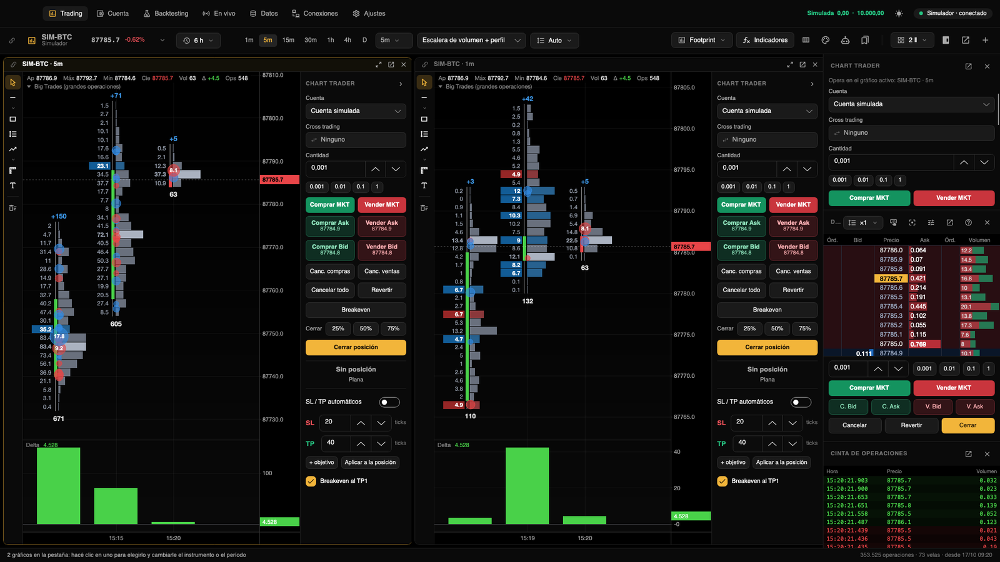

[← Volver al índice](README.md)

# Primeros pasos

Un recorrido por la ventana principal para que sepas dónde está cada cosa. Si todavía no la instalaste, empezá por
[Instalación](instalacion.md).

## La primera vez

Al abrir Trading Hub por primera vez aparece la sección **Trading** con un gráfico de `SIM-BTC` en 5 minutos, en
modo footprint, con los indicadores Big Trades y Delta. Ese instrumento sale del **Simulador**, un mercado simulado
que funciona sin internet y sirve para practicar.

Todo lo que operes va a la **cuenta simulada**. Nada mueve dinero real hasta que lo habilites a mano, conexión por
conexión, en [Conexiones](conexiones.md).

Estas conexiones ya vienen creadas:

| Conexión | Al empezar | Qué da |
|---|---|---|
| Simulador | activada | SIM-BTC, SIM-ETH, SIM-ES y SIM-NQ simulados |
| Binance Futures | activada | datos públicos de cripto, sin cuenta |
| Binance Spot | activada | datos públicos de cripto, sin cuenta |
| Bybit | activada | datos públicos de los perpetuos en USDT |
| Rithmic | desactivada | futuros de CME (necesita tus credenciales) |

## La ventana principal

### Las secciones, en la barra de título

La navegación va integrada en la barra de título de macOS, al lado de los botones de la ventana:

| Sección | Atajo | Para qué |
|---|---|---|
| Trading | ⌘1 | Gráficos, DOM, cinta de operaciones y Chart Trader. |
| Cuenta | ⌘5 | Saldo, posiciones, órdenes, ejecuciones, operaciones y estadísticas. |
| Backtesting | ⌘2 | Estrategias en C#, backtests, optimización y el chat con Claude. |
| En vivo | ⌘7 | Estrategias automáticas corriendo, portafolios y el botón «Frenar todo». |
| Datos | ⌘3 | Historia guardada, descargas, importar archivos, Databento y replay. |
| Conexiones | ⌘4 | Mercados, brokers y cuentas. |
| Ajustes | ⌘, | Apariencia, zona horaria, atajos, modo sin dormir y carpetas. |

Con la ventana angosta (menos de 1360 píxeles de ancho) la barra muestra solo los íconos; el nombre aparece al pasar
el mouse. Arrastrando la barra movés la ventana y con doble clic la maximizás.

### A la derecha de la barra

- **Simulada 0,00 · 10.000,00**: el resultado del día y el saldo de la cuenta simulada. Hacé clic para ir a Cuenta.
- **Sol o luna**: pasa a modo claro u oscuro.
- **Píldora de conexión**: la conexión del gráfico activo y su estado. Un clic abre un menú con «Reconectar ahora» y
  «Conexiones…».

| Estado | Qué significa |
|---|---|
| conectado | Llegan datos. |
| conectando… / reconectando… (intento N) | Se está conectando; después de un corte, lo que faltó se rellena solo. |
| sin datos hace N min | La conexión sigue, pero no llega nada hace rato. |
| mercado cerrado · abre (día y hora) | Futuros fuera de horario: no es un corte, los datos vuelven solos. |
| error / desconectado | Revisá la conexión en Conexiones. |

Si la Mac se durmió, al volver Trading Hub reconecta solo y rellena lo que faltó.

### La barra de estado

Abajo de todo. A la izquierda aparece el último aviso: órdenes enviadas, cargas de historia, alertas de precio y
errores (al pasar el mouse se ve entero). A la derecha, el resumen del gráfico activo: «N operaciones · N velas ·
desde dd/MM HH:mm», o «Cargando historia N%» mientras carga.

## La sección Trading

1. **Barra del gráfico**, arriba: instrumento, historia, períodos, tipo de gráfico, indicadores, footprint, colores,
   estrategias, plantillas, diseño, paneles, ventana aparte y pestaña nueva. Todo se explica en [Gráficos](graficos.md).
2. **Pestañas**: la tira aparece cuando hay más de una. Cada pestaña puede tener de 1 a 6 gráficos.
3. **El gráfico**, con su barra de dibujos a la izquierda y su propio Chart Trader a la derecha (se pliega con la
   flechita).
4. **Panel derecho**: Chart Trader, DOM y Cinta de operaciones, uno debajo del otro. El ancho se cambia arrastrando el
   borde y el alto de cada sección, con los divisores. Cada sección se oculta con su cruz o se saca a una ventana aparte.
5. **Barra de replay**, abajo: aparece cuando el gráfico activo es un replay (ver [Datos](datos.md#replay)).

Para operar, mirá [Operar](operar.md).

## La cuenta simulada

- Arranca con un saldo de 10.000. Lo cambiás en **Cuenta → Saldo inicial**.
- Sirve con cualquier mercado: el Simulador o datos reales de Binance, Bybit, Rithmic y las demás conexiones.
- Llena las órdenes contra el mercado real: a mercado, al mejor bid o ask; las límite, cuando el precio opera a través
  de tu precio o cuando en tu precio se operó más volumen que el que tenías adelante en la cola al mandarla; las stop,
  cuando opera el precio de disparo, y ahí llenan a mercado.
- El saldo y el historial se guardan: no vuelven a cero al cerrar la app. Para empezar de cero, usá «Reiniciar la
  cuenta simulada» en Cuenta.

## Abrir un gráfico

1. En Trading, hacé clic en el selector de instrumento (el primer botón de la barra del gráfico) o tocá ⌘K.
2. Arriba elegí la conexión, o **Favoritos** para ver solo los marcados.
3. Escribí para buscar (BTC, ETH, NQ…). Con las flechas te movés por la lista.
4. Enter o doble clic lo abre en el gráfico activo. ⌘Enter lo abre en una pestaña nueva.
5. La estrella de cada fila lo marca como favorito.

Al abrir, se carga la historia reciente (cuánta, lo define cada conexión). Para ver más hacia atrás usá el botón de
historia de la barra. Una pestaña nueva se abre con ⌘T o con el botón **+**: copia el gráfico activo, salvo que hayas
elegido una plantilla para las pestañas nuevas. ⌘W cierra el gráfico activo; siempre queda al menos una pestaña.

Para ver mercados reales con tus cuentas, agregalos en [Conexiones](conexiones.md).

## El menú de la Mac

Con Trading Hub al frente, la barra de menú de macOS tiene estos menús:

| Menú | Opciones |
|---|---|
| Archivo | Nuevo gráfico (⌘T), Cerrar gráfico (⌘W), Buscar instrumento… (⌘K), Guardar espacio de trabajo (⌘S), Abrir carpeta de datos |
| Gráfico | Indicadores… (⌘I), Editar footprint… (⇧⌘F), Escala automática (⌥⌘A), Ir al último precio (⌘Fin), Diseño, Sacar gráfico a una ventana (⇧⌘D), Paneles, Configurar DOM… |
| Ir | Las siete secciones, con sus atajos |
| Código | Editor de indicadores… (⇧⌘E), Abrir carpeta de indicadores, Recompilar indicadores, Backtesting de estrategias…, Estrategias en vivo…, Abrir carpeta de estrategias |

El espacio de trabajo (pestañas, gráficos, diseños y paneles) también se guarda solo al cerrar y se recupera al abrir.

## El ícono en la barra de menú

Trading Hub deja un ícono arriba a la derecha, en la barra de menú de macOS. Al tocarlo se abre un menú con:

- la conexión del gráfico activo;
- **Estrategias en vivo (N)**, con el tamaño, la posición y el resultado de cada una;
- **Posiciones abiertas (N)**;
- «Ver el panel en vivo…», «Abrir Trading Hub» y «Salir de Trading Hub».

El panel en vivo muestra las estrategias y las posiciones en tiempo real, con los mismos botones para abrir o salir.

**Cerrar no es salir.** El botón rojo de la ventana la oculta y Trading Hub sigue corriendo en la barra de menú, con
las estrategias trabajando. El ícono y este comportamiento dependen de **Ajustes → Estrategias en vivo → Seguir en la
barra de menú al cerrar la ventana**, que viene activado; si lo apagás, el ícono desaparece y cerrar la ventana cierra
la app. Para salir del todo usá ⌘Q o «Salir de Trading Hub». Si la ventana está oculta, tocar el ícono del Dock la
vuelve a abrir.

## Atajos de teclado

Además de los del menú, en **Ajustes → Atajos de teclado** hay atajos configurables. Funcionan en Trading y en las
ventanas de gráfico aparte, sobre el gráfico activo. Para cambiar uno, hacé clic en su botón y presioná la
combinación; Esc cancela y ⌫ lo deja sin asignar. «Restablecer los de fábrica» vuelve a los originales.

| Atajo de fábrica | Acción |
|---|---|
| ⌥1 a ⌥6 | Período de 1 minuto, 5 minutos, 15 minutos, 1 hora, 4 horas y diario |
| ⌥H | Dibujar una línea horizontal |
| ⌥T | Mostrar u ocultar el Chart Trader del gráfico |
| ⌃Tab / ⌃⇧Tab | Pestaña siguiente / anterior |

Los atajos para operar (comprar, vender, cerrar, revertir, cancelar, parciales, breakeven y otros) vienen sin asignar
a propósito: cada uno elige los suyos. Ver [Operar](operar.md#atajos-para-operar).

Sobre el gráfico también funcionan:

| Tecla | Acción |
|---|---|
| Esc | Vuelve al cursor, cancela el arrastre de una orden o quita el resaltado de una operación |
| ⌫ o Supr | Borra los dibujos seleccionados |
| Inicio o Fin | Vuelve a lo último con escala automática |
| ← / → | Desplaza el gráfico |
| + / − | Agranda o achica las velas |

## Ajustes que conviene mirar

- **General**: apariencia (oscuro o claro), zona horaria de los gráficos y sonidos de alerta.
- **Operar**: «Confirmar órdenes reales» (ver [Operar](operar.md#seguridad)).
- **Estrategias en vivo**: seguir en la barra de menú, reanudar las estrategias al abrir y elegir el contrato solo
  (minis o micros).
- **Modo sin dormir**: la Mac no se duerme mientras haya estrategias en vivo; opcionalmente, sigue con la tapa cerrada.
- **Datos**: «Grabar lo que llega en vivo» y los accesos a las carpetas.

## Qué sigue

- [Conexiones](conexiones.md): sumar mercados y brokers.
- [Gráficos](graficos.md): períodos, footprint, dibujos, indicadores y plantillas.
- [Operar](operar.md): Chart Trader, DOM, órdenes, stop y objetivos, y la sección Cuenta.
- [Datos](datos.md): historia guardada, descargas, importación, Databento y replay.
